# SUBDESTRUCKT · ARCH-UI-04-R2-B1 — Component Lab

Premier jalon de R2-B. Ce laboratoire isolé prototype les composants R2 avec les vraies primitives graphiques JUCE,
avant leur intégration. **Ce n'est ni le plugin, ni une application musicale, ni une version** : le plugin de
production 0.4.1 est inchangé, et aucune valeur affichée ici n'est une mesure du moteur (**DEMO DATA**). La validation
artistique revient au propriétaire. R2-B2, R2-C et ARCH-UI-05 ne sont pas autorisés.

| Document | Contenu |
|---|---|
| [R2-B1-REPORT.md](R2-B1-REPORT.md) | Rapport de clôture |
| [COMPONENT-DESIGN-SPEC.md](COMPONENT-DESIGN-SPEC.md) | Composants réalisés, architecture réutilisable, écarts avec R2-A |
| [DESIGN-TOKENS-R2.md](DESIGN-TOKENS-R2.md) | Tokens dérivés, typographie, gabarits, contrastes mesurés |
| [TYPOGRAPHY-MEASUREMENTS.csv](TYPOGRAPHY-MEASUREMENTS.csv) | PT-02 : 2 213 occurrences × 2 plateformes, zooms 75 / 100 / 150 % |
| [P1-NAMING-REVIEW.md](P1-NAMING-REVIEW.md) | 323 libellés P1 groupés pour arbitrage (aucun n'est validé) |
| [GLYPH-VALIDATION.md](GLYPH-VALIDATION.md) | PT-05 : `→ · … −` et repli ASCII |
| [INTERACTION-TEST-PLAN.md](INTERACTION-TEST-PLAN.md) | Stratégie OD-01, migration des tests pour R2-B2, protocoles PB-01 / PB-02 |
| [`CAPTURES/macos/`](CAPTURES/macos), [`CAPTURES/windows/`](CAPTURES/windows) | 12 planches par plateforme, rendu ×2 (sauf la planche 9) |
| [`CONTACT-SHEETS/`](CONTACT-SHEETS) | Planches-contact |
| [`data/`](data) | Mesures brutes, journaux et machine de chaque plateforme |
| [`../../../lab/`](../../../lab/README.md) | Code du laboratoire et outils reproductibles |

## Provenance des rendus

| Dossier | Plateforme | Polices résolues | Nature |
|---|---|---|---|
| `CAPTURES/macos/` | macOS 15.8.2 arm64, **VM GitHub Actions** (workflow `component-lab.yml`) | Lucida Grande / Menlo | Rendu logiciel JUCE hors écran. **Ce n'est pas une recette physique macOS.** |
| `CAPTURES/windows/` | Windows 11, poste local, MSVC 2022 | Verdana / Lucida Console | Rendu logiciel JUCE hors écran. Ce n'est pas la plateforme cible. |

Chaque planche porte en en-tête la plateforme, la version JUCE et les polices réellement résolues. Les planches sont
rendues au facteur 2 (équivalent Retina) pour la revue à distance. La planche 9 est en pixels écran ×1, le cas le plus
défavorable.

## Planches (macOS)

### 1. Planche complète
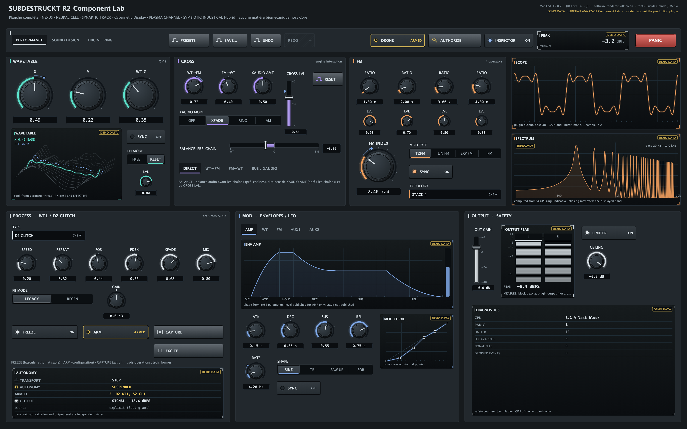

### 2. NEXUS XL · S · Micro
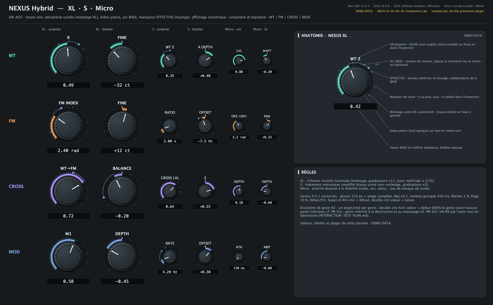

### 3. NEURAL CELL (six traitements ; FREEZE · ARM · AUTHORIZE · CAPTURE)
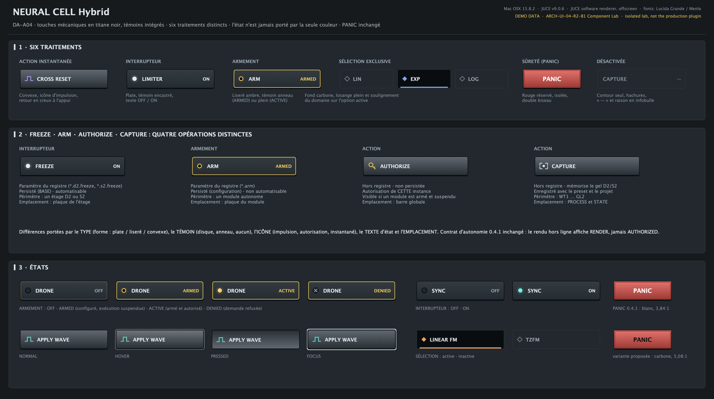

### 4. SYNAPTIC TRACK
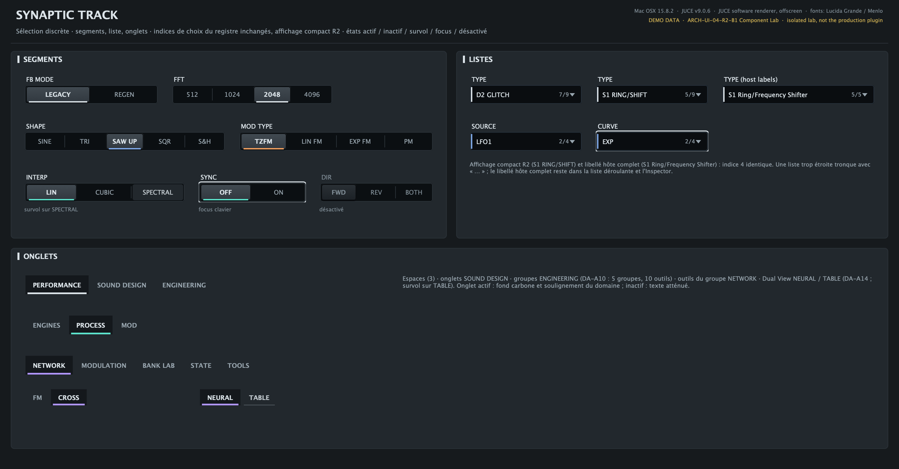

### 5. Cybernetic Display
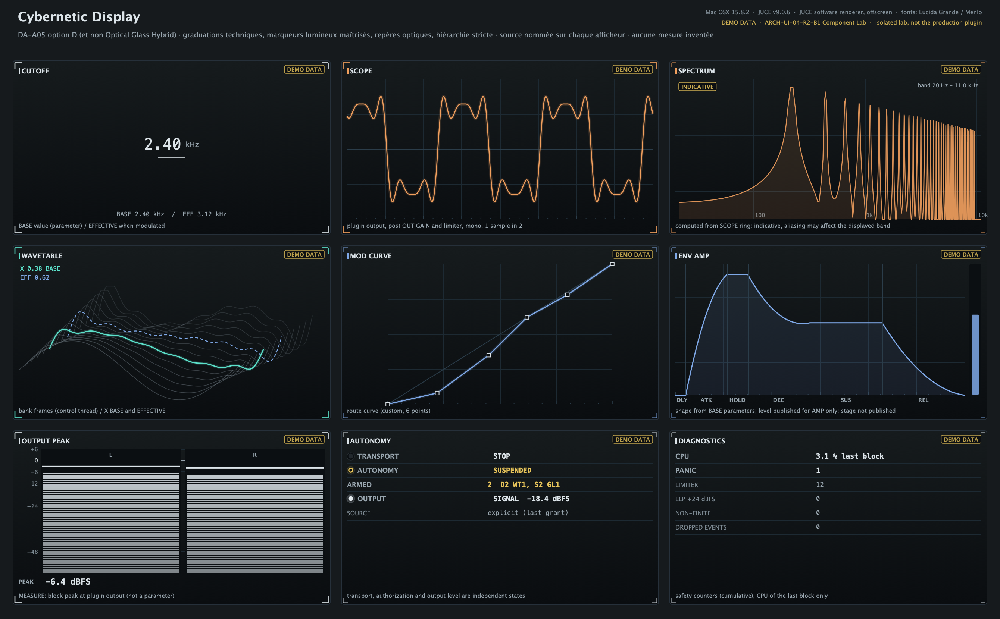

### 6. PLASMA CHANNEL (paramètre ≠ mesure)
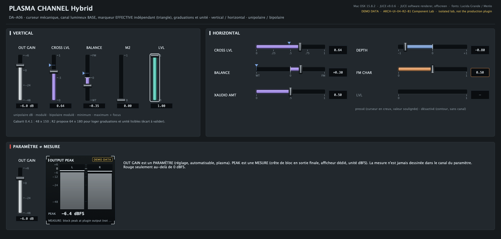

### 7. États interactifs
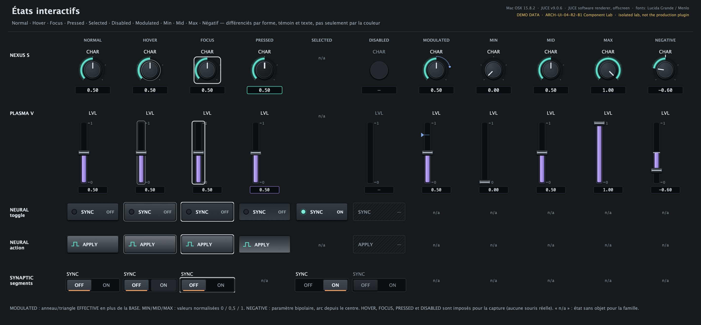

### 8. Couleurs par moteur
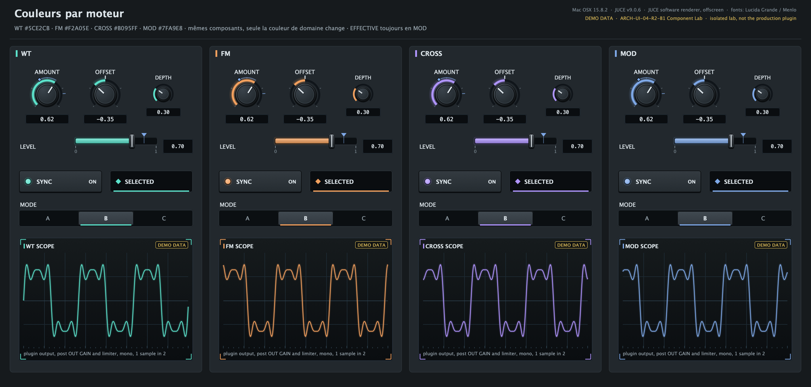

### 9. Comparatif 75 / 100 / 150 % (pixels écran ×1)
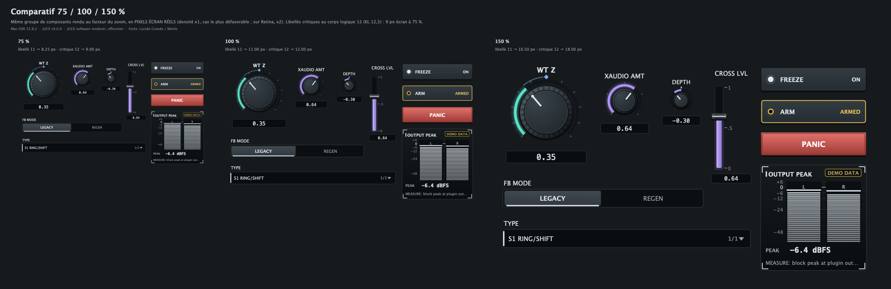

### 10. Cas typographiques critiques et glyphes
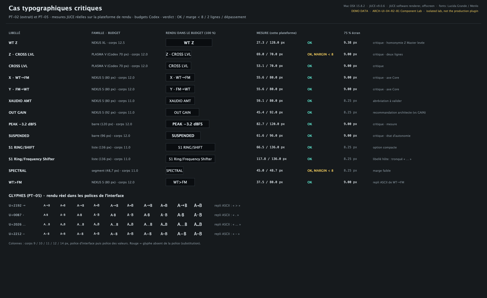

### 11. Comparatif 0.4.1 / R2 (mêmes paramètres réels)
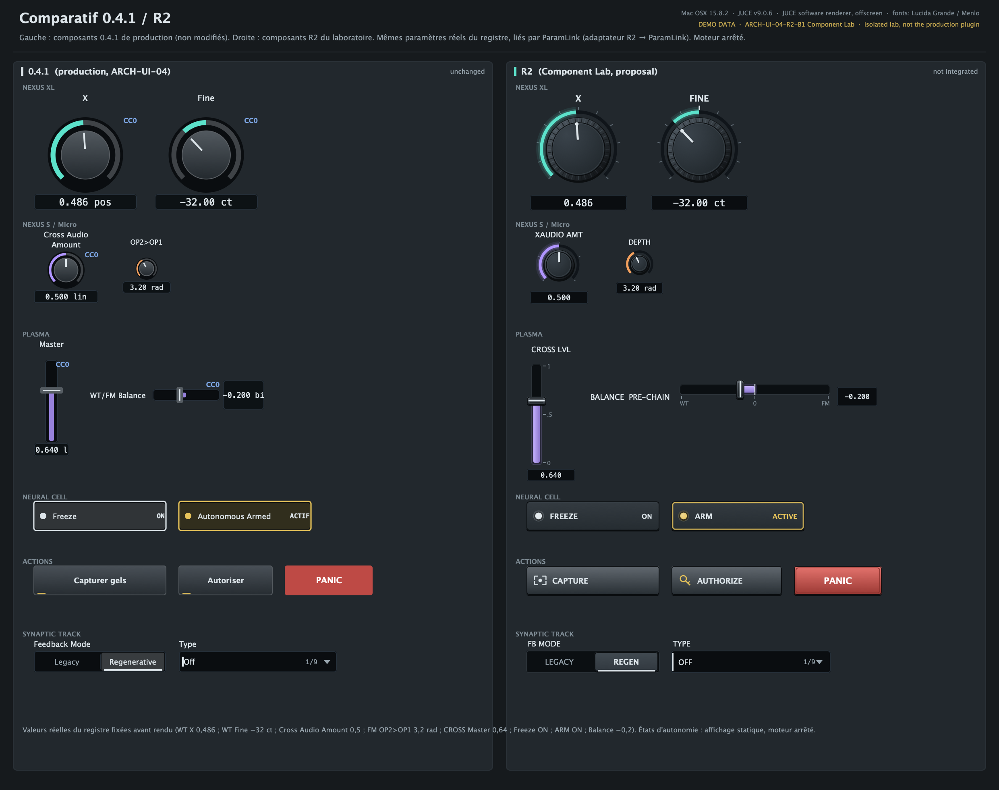

### 12. Regroupement en plaques WT et CROSS
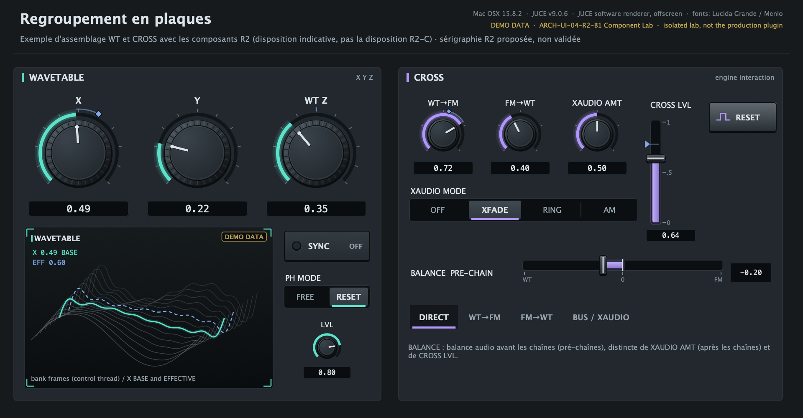

Les mêmes planches rendues sous Windows sont dans [`CAPTURES/windows/`](CAPTURES/windows). On y voit les différences
de police (Verdana, plus large) et de glyphe (`→` substitué dans Verdana).

## Reproduire

```bash
cmake -S lab -B build-lab -G Ninja -DCMAKE_BUILD_TYPE=Release -DSUBDESTRUCKT_JUCE_DIR=<JUCE 9.0.6>
cmake --build build-lab
build-lab/sbd_component_lab_artefacts/Release/sbd_component_lab --all out --csv docs/ARCH-UI-04-R2/R2-CONTROL-LABELS-PROPOSALS.csv --scale 2
build-lab/sbd_lab_compare_artefacts/Release/sbd_lab_compare out/CAPTURES/11-compare-041-r2.png 2
py -3.11 lab/tools/build_review.py          # fusion des mesures et revue P1
py -3.11 lab/tools/gen_labels.py --check    # le CSV de nomenclature R2-A se régénère à l'identique
```
