# SUBDESTRUCKT · ARCH-UI-04-R2-B1-R1 — raffinement artistique final

Application des huit arbitrages artistiques du propriétaire, LAB-A01 à LAB-A08, au Component Lab. C'est la dernière
étape avant l'intégration R2-B2, qui **n'est pas autorisée**. Ni le plugin ni sa version 0.4.1 ne changent. Toutes les
valeurs affichées sont des données de démonstration (**DEMO DATA**). La validation artistique finale (AR-15) appartient
au propriétaire.

| Document | Contenu |
|---|---|
| [R2-B1-R1-REPORT.md](R2-B1-R1-REPORT.md) | Rapport de clôture |
| [LAB-ARTISTIC-DECISIONS.md](LAB-ARTISTIC-DECISIONS.md) | Les huit arbitrages, leur application, les preuves, les critères AR-01 à AR-15 |
| [COMPONENT-DESIGN-FINAL.md](COMPONENT-DESIGN-FINAL.md) | Spécification finale des composants remise à R2-B2 |
| [P1-NAMING-VALIDATION.md](P1-NAMING-VALIDATION.md) | Nomenclature P1 : statut lexical validé, statut géométrique mesuré, contrôles exigés |
| [P1-TRACEABILITY.csv](P1-TRACEABILITY.csv) | Une ligne par occurrence P1 (324 : 323 + l'en-tête CROSS AUDIO ajouté par LAB-A08) |
| [TYPOGRAPHY-MEASUREMENTS.csv](TYPOGRAPHY-MEASUREMENTS.csv) | PT-02 sur la révision R1 : 2 214 occurrences × 2 plateformes, zooms 75 / 100 / 150 % |
| [CONTRAST-REPORT.md](CONTRAST-REPORT.md) | Contrastes des tokens et de PANIC sur la surface rendue |
| [`../R2-CONTROL-LABELS-R1.csv`](../R2-CONTROL-LABELS-R1.csv) | Nomenclature révisée (LAB-A08) |
| [`CAPTURES/macos/`](CAPTURES/macos), [`CAPTURES/windows/`](CAPTURES/windows), [`CONTACT-SHEETS/`](CONTACT-SHEETS), [`data/`](data) | Rendus, planches-contact, mesures brutes et journaux par plateforme |
| [`../B1-COMPONENT-LAB/`](../B1-COMPONENT-LAB/README.md) | Preuves B1 conservées pour la comparaison historique |

## Provenance des rendus

| Dossier | Plateforme | Polices | Nature |
|---|---|---|---|
| `CAPTURES/macos/` | macOS 15 arm64, **VM GitHub Actions** (`component-lab.yml`) | Lucida Grande / Menlo | Rendu logiciel JUCE hors écran. Le SHA du code de rendu figure en en-tête de chaque planche. **Ni une recette macOS physique, ni une recette dans Reason.** |
| `CAPTURES/windows/` | Windows 11, poste local | Verdana / Lucida Console | Rendu logiciel JUCE hors écran, comparatif. **Pas une recette macOS.** |

Les planches sont rendues au facteur 2 (équivalent Retina). Les planches 06b et 09 sont en pixels écran réels ×1, le cas
le plus défavorable. Dans les comparatifs avant / après, la révision B1 et la révision R1 sont rendues dans la même
exécution, avec les mêmes dimensions, valeurs, contextes et données.

## Planches (macOS)

### 1. Planche complète finale
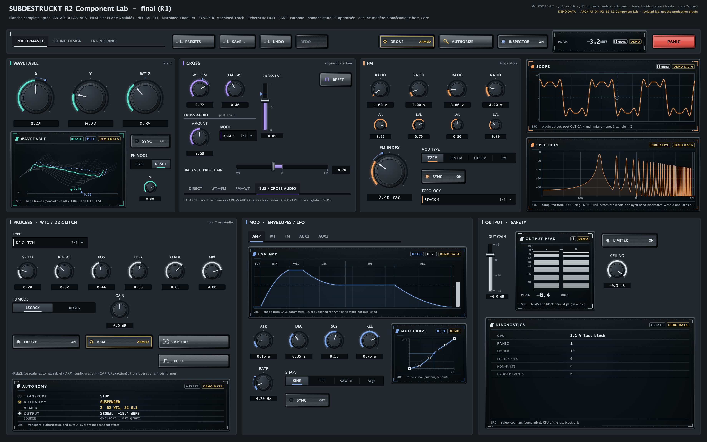

### 2. NEXUS — non-régression artistique (pixel à pixel contre la capture B1)
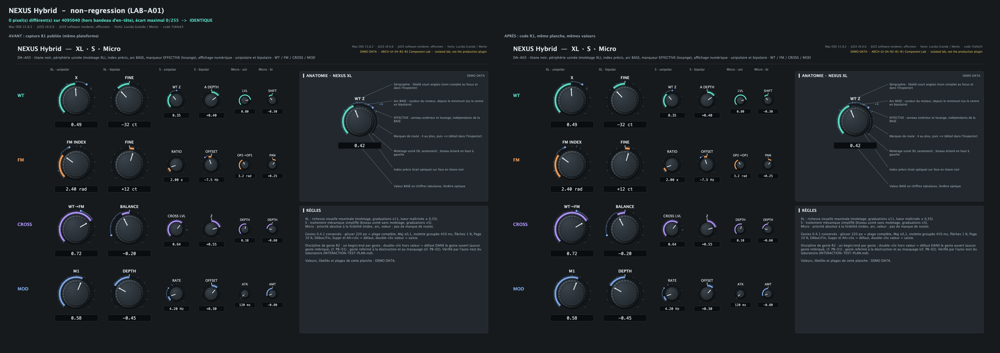

### 3. NEURAL CELL — avant / après (Machined Titanium)
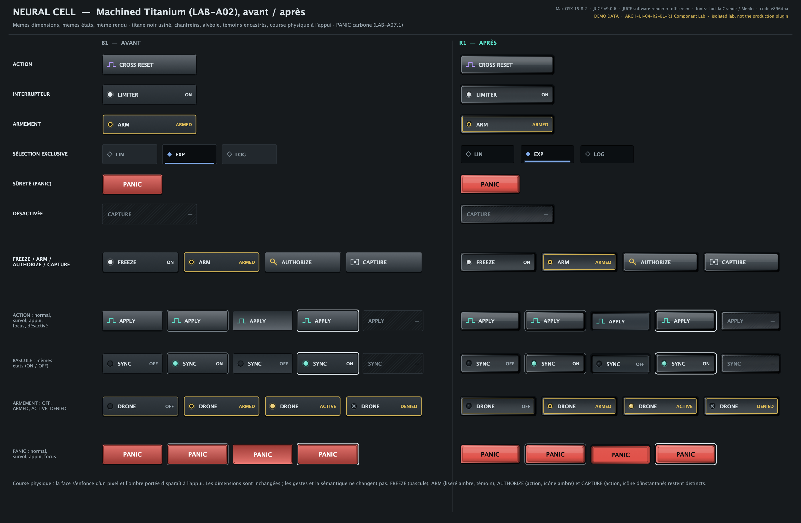

### 4. SYNAPTIC TRACK — avant / après (Machined Track)
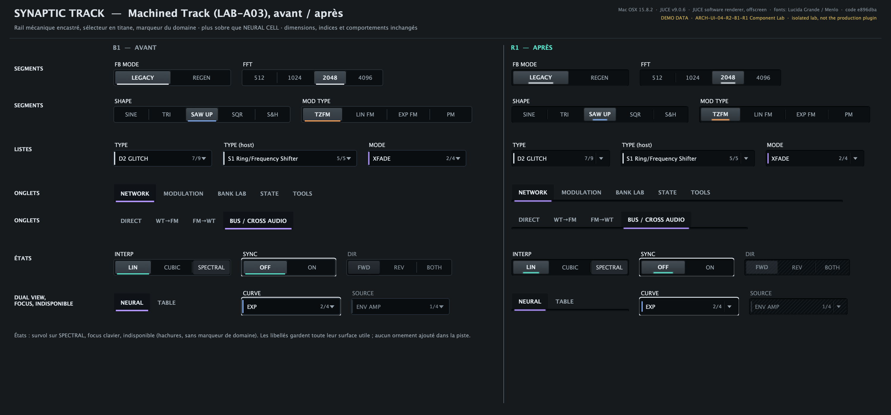

### 5. Cybernetic HUD — neuf variantes, puis avant / après
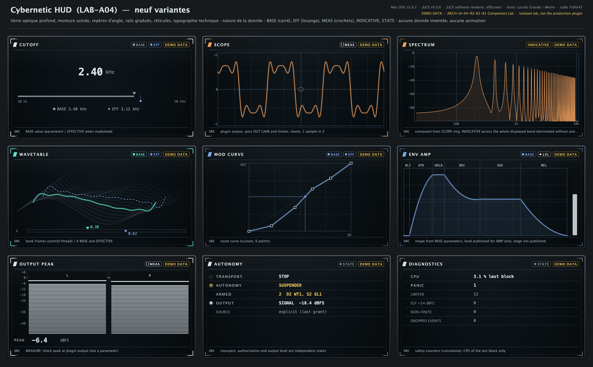
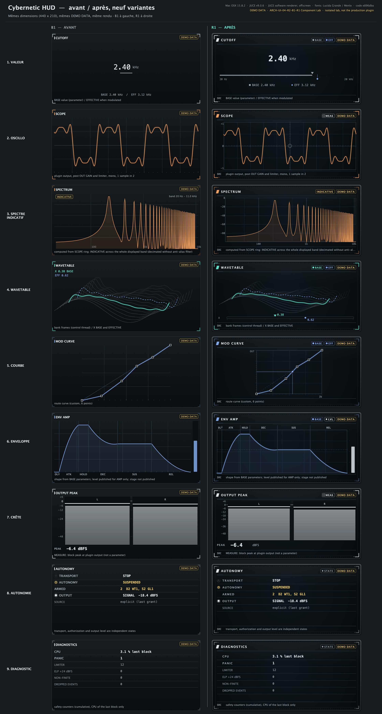

### 6. PLASMA — STANDARD / COMPACT, zooms et non-régression
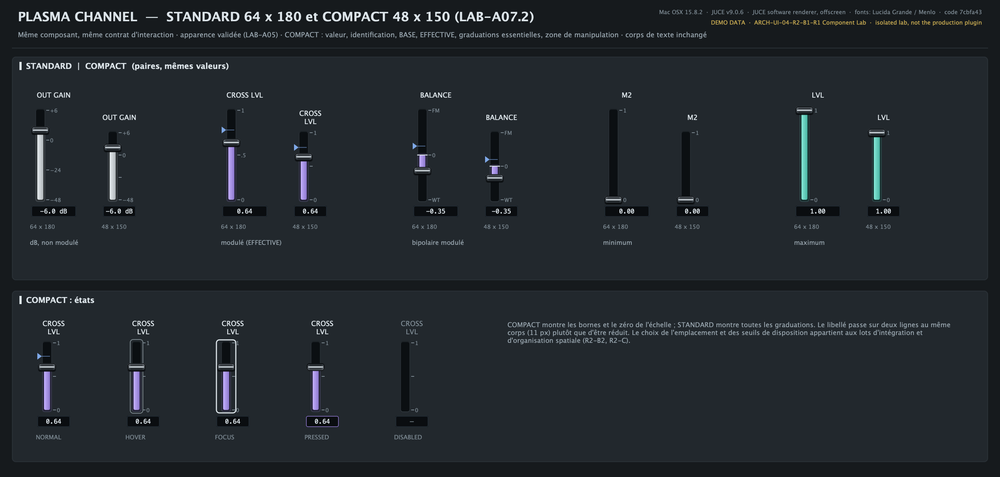
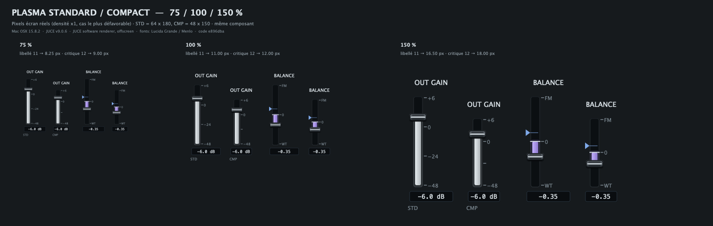
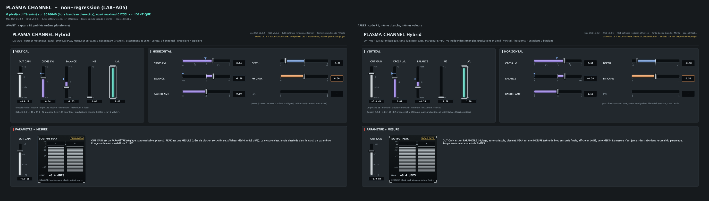

### 7. PANIC définitif et états interactifs
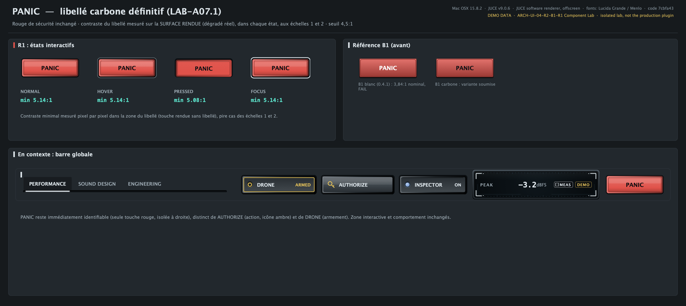

### 8. Assemblage WT / CROSS / FM
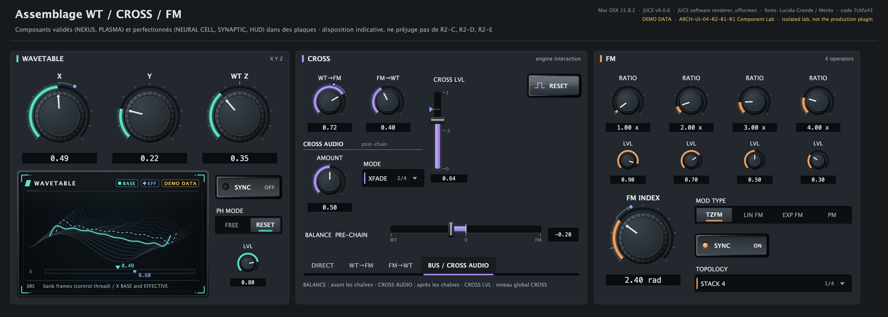

### 9. Zooms 75 / 100 / 150 %
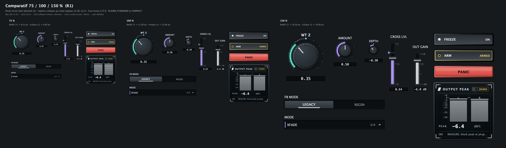

### 10. Nomenclature critique
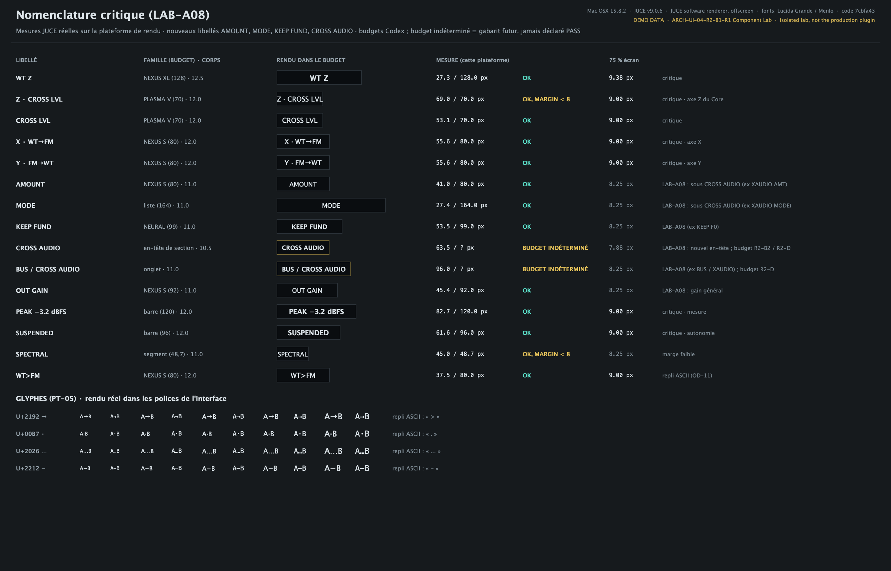

### 11. Cohérence des matériaux et de la palette
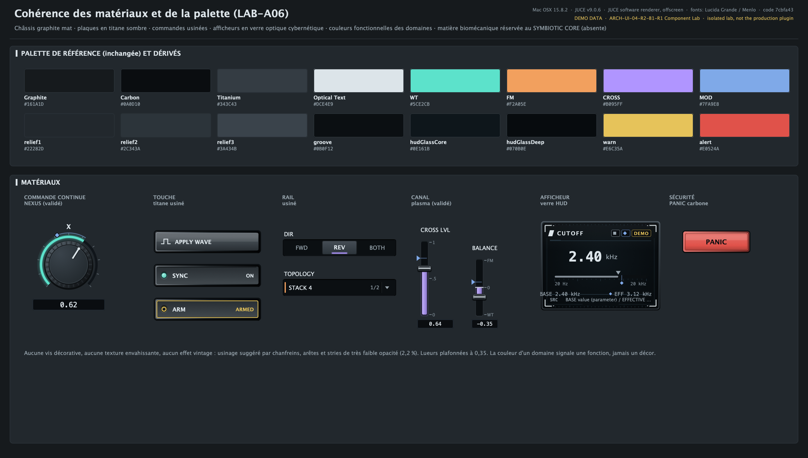

### 12. Comparatif 0.4.1 / R2 (mêmes paramètres réels)
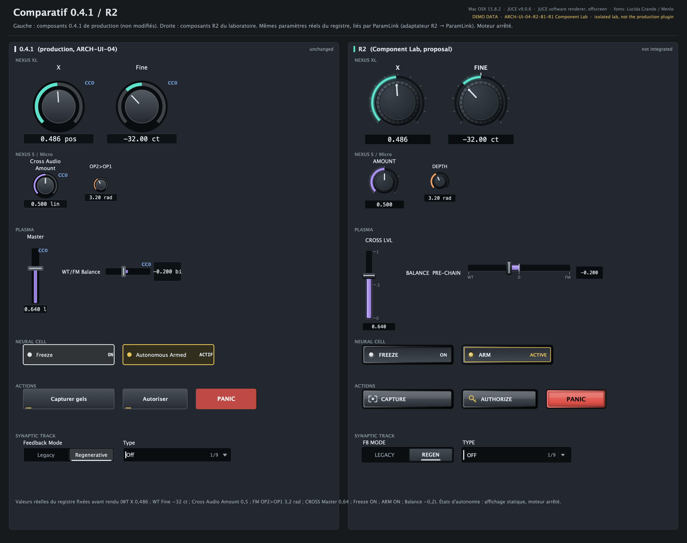

Planches-contact : [macOS](CONTACT-SHEETS/contact-sheet-macos.png) ; [Windows](CONTACT-SHEETS/contact-sheet-windows.png) ;
[Windows B1 régénérée](CONTACT-SHEETS/contact-sheet-windows-B1.png). Cette dernière est construite à partir des captures
B1 inchangées ; la planche-contact Windows publiée en B1 était noire, voir l'erratum du rapport B1.

## Reproduire

Voir [`lab/README.md`](../../../lab/README.md). En résumé : `sbd_component_lab --all` sur la révision R1, avec `--b1`
pointant vers les captures B1 de la même plateforme, puis `py -3.11 lab/tools/build_validation_r1.py`.

## Addendum — décision du propriétaire (2026-11-28)

**AR-15 : PASS** (option A, validation artistique complète, décision humaine). ARCH-UI-04-R2-B1-R1 : **GO FINAL**. Design
System R1 gelé. Détail et portée : [OWNER-DECISION-AR15.md](OWNER-DECISION-AR15.md). Le contenu ci-dessus est conservé tel
qu'il a été publié avant la décision.
